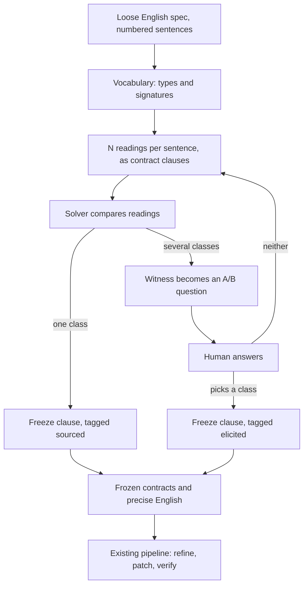

# Spec elicitation loop: from loose English to frozen contracts

**Status:** draft proposal, not implemented
**Date:** 2026-11-15
**Baseline:** LLMLL v0.28.0, as described in the README. The driver and `LLMLL.md` were not reviewed, so points marked *(assumed)* need checking against the code.

## Summary

Today an agent reads an RFC and writes contracts in one step. Nothing measures whether those contracts say what the English says. `--weakness-check` and `--cdp` measure non-vacuity, and the README is explicit that they do not measure fidelity.

This proposal adds a stage before the lead agent. Several agents formalize each English sentence independently. The solver compares their readings. Where two readings disagree, the solver produces a concrete case, and a human decides which reading is right. The answers become sourced contract clauses. The rest of the pipeline is unchanged.

## Goals

- Start from English that is looser than RFC pseudocode.
- Flag imprecision with a concrete witness, not an LLM's opinion.
- Record every interpretive decision with provenance.
- Report fidelity as its own trust axis.

## Non-goals

- Proving that the English itself is correct.
- Catching misreadings that every agent shares.
- Verifying effects, timers or byte-level parsing.

## The flow



The loop ends for a function when every clause slot has one equivalence class and the coverage check passes.

## Design

### 1. Numbered sentences

The English spec is split into sentences with stable IDs. Every later artifact points back to these IDs. Sentences the LLM pass classes as vague or non-normative ("should probably", "reasonable") are flagged directly and never reach the solver.

### 2. Vocabulary step

Types and function signatures are fixed before any hole exists. The solver cannot compare readings that disagree about types, so this step needs human review of its own. It is the main place where ambiguity can still hide.

### 3. Contract-position holes (new)

A hole in a single clause slot of a `pre` or `post`, one per source sentence. The body hole stays locked until the contract is frozen. The `holes --deps` graph may already be able to express that dependency *(assumed)*.

### 4. Checkout for readings

`checkout --multi N` on the clause pointer, as it works for bodies today. The brief changes. It returns:

- the source sentence and its neighbors
- the signature and the types in scope
- clauses already frozen for this function
- prior decisions that touch the same terms

Each agent submits one boolean expression. Different models or prompts per token reduce shared misreadings.

### 5. Gates on each reading

All reuse existing checks:

| Gate | Existing mechanism |
|---|---|
| Type-checks as `bool` | type checker |
| Feasible: some output satisfies it for every allowed input | `refine` no-miracle gate |
| Not vacuous | `--weakness-check`, `--cdp` |
| Inside the decidable fragment | `outside_fragment` partition in `diverge-report` |

Readings are restricted to expressions over the inputs and the result, plus inlined pure definitions. A reading that calls a function known only by its contract lets the solver invent false disagreements.

### 6. The comparison query (new, core)

For readings A and B of one clause, ask Z3 for values that satisfy all of:

- the frozen precondition
- A
- the negation of B

Then swap A and B and ask again.

| Result | Meaning |
|---|---|
| sat | The model is a case A accepts and B rejects. This is the witness. |
| unsat | A implies B. Unsat in both directions means equivalent. |
| unknown or timeout | No verdict. Fail closed, as `patch` does with exit 3. |

Example. Sentence: "the amount must not exceed the balance." A is `amount <= balance`. B is `amount < balance`.

```smt2
(declare-const amount Int)
(declare-const balance Int)
(assert (>= amount 0))            ; frozen pre
(assert (<= amount balance))      ; A
(assert (not (< amount balance))) ; not B
(check-sat) (get-model)
```

Z3 returns sat with `amount = balance`. The reverse direction is unsat, so A is strictly weaker.

The inputs and result are free constants, so the query has no quantifiers. Inside the linear-arithmetic, array and datatype fragment it always terminates with a definite answer.

Implementation notes:

- liquid-fixpoint answers SAFE or UNSAFE. Concrete values probably need a direct Z3 call with `get-model`. The `refine` gate already reports a witnessing input, so a path may exist to reuse *(assumed)*.
- Use Z3's optimizer to minimize witness values so the question reads naturally.
- Keep one representative per equivalence class and compare each new reading against those.
- Freeze `pre` before `post`. Postconditions are compared only on inputs the precondition allows.
- Two readings can differ in several independent ways. Rerun the comparison on the surviving readings after each answer.

### 7. `diverge-report` for readings

For bodies, the report partitions fills by verdict against a contract. For readings it groups them into equivalence classes and emits:

- one class: converged
- several classes: a `divergence_witness` per pair of classes
- strict implication: reported separately, with a case the weaker reading permits and the stricter one forbids

### 8. Question and decision

The driver turns each witness into a scenario with an A/B answer. The human sees the question and the case, never the contracts. The driver asks first the question that splits the candidate readings most evenly.

The answer selects a class. That reading is patched into the file with a new `:source` kind, for example `:source (decision D7)`, which links the question, the witness and the answer. The answer is also written back as a new sentence in the English spec. If the answer is "neither", it joins the brief and the session reruns.

### 9. Fidelity axis in the trust report (new)

Each clause carries one of:

| Label | Meaning |
|---|---|
| `sourced` | Readings converged on an English sentence |
| `elicited` | A human decision resolved a divergence |
| `inferred` | Written by an agent with no source |

`--strict-verify` could refuse `inferred`. `--spec-coverage` gains a second ratio: normative sentences with at least one clause.

### 10. Coverage and consistency checks

Two more checks use the same witnesses-first approach:

- **Incompleteness:** an allowed input that no clause constrains.
- **Inconsistency:** an allowed input for which the clauses cannot all hold. This is the existing feasibility gate applied to the whole contract.

## What changes where

| Component | Change |
|---|---|
| Compiler | Contract-position holes; reading comparison query; `:source` decision kind; fidelity axis |
| `checkout` / `diverge-report` | Reading mode: new brief, equivalence classes |
| RFC-SWARM driver | Sentence splitter, vocabulary step, question generation and ordering, answer write-back |
| `refine`, `patch`, `verify` | None |

## Worked example: ARP (RFC 826)

Expected flags from the 1982 text:

- **Ambiguity:** the length checks are optional and no consequence is stated. One reading drops a bad packet, another processes it.
- **Ambiguity:** "am I the target" for a host with several addresses.
- **Incompleteness:** a full table; a sender hardware address equal to broadcast.
- **Surprising consequence:** a packet claiming my own protocol address is merged into my table. This surfaces only with a sanity invariant.
- **Vagueness:** the table-aging text is suggestion, not rule.

Fragment gaps for ARP: map keys are limited to int or string, so the composite table key needs encoding. Whole-map equality is contract-only, so the frame condition "no other entry changes" probably lands as `asserted` today.

## Evaluation

1. **Prototype the comparison query on `rfc1982_serial`.** It is in-fragment and already `:source`-tagged. The question is whether independent readings ever diverge on real RFC text.
2. **ARP from loose English, with RFC 826 as the answer key.** A simulated answerer grounded in the RFC stands in for the human. Measure the number of questions needed to converge on RFC behavior.
3. **History as a second answer key.** RFC 1122 later patched cache aging and packet queuing. RFC 5227 added address conflict detection. Count how many of those gaps the loop raises from the 1982 text alone.
4. **Report** verified fraction as the share of normative sentences covered by `sourced` or `elicited` clauses that also pass the weakness and CDP checks.

## Risks and limits

- **Correlated misreadings.** If all readings agree on a wrong interpretation, nothing is flagged. Agreement is not evidence of precision.
- **Vocabulary.** Ambiguity in the types and signatures is outside the solver's reach.
- **Fragment.** Comparison is sound only in the decidable core. Strings, quantifiers and nonlinear arithmetic fall out.
- **Question volume.** The number of questions may grow faster than a human will tolerate.
- **Human error.** A wrong answer is frozen as a decision. Later answers that contradict earlier ones can be detected by the consistency check.
- **Elicitation can hurt.** A NeurIPS 2026 study on Lean specs found that open-ended clarifying questions lowered accuracy in a same-model setup. This design answers that by letting only the solver originate questions.

## Prior art

- [TiCoder](https://arxiv.org/html/2404.10100v1): clarifies intent through yes/no questions on generated tests. Output is tests, not contracts.
- [AWS Automated Reasoning checks](https://aws.amazon.com/about-aws/whats-new/2026/06/amazon-bedrock-guardrails/): English policy to formal logic, with an explicit ambiguity finding. Does not produce code.
- [nl2spec](https://trippel-lab.stanford.edu/pubs/cosler_CAV23.pdf) and [ClarifySTL](https://newx.sg/paper/detail/a290d753-49c1-11f1-b84c-00163e10baa7): interactive formalization, temporal logic only.
- [Eliciting Specifications: When Does Interactive Clarification Help?](https://neurips.cc/virtual/2026/171451): the caution above.

A search did not turn up a pipeline that combines multiple formalizations, solver-generated witnesses and verified code. That search was brief and is not a novelty claim.

## Open questions

1. Is one hole per sentence the right grain, or should agents be free to split and merge sentences?
2. Should a sentence's placement in `pre` versus `post` itself be a compared choice?
3. How large should N be, and how much does model diversity reduce correlated misreadings?
4. Should `elicited` decisions expire when the English sentence they hang on changes?
5. Can frame conditions over maps be brought into the fragment, since proving a universally quantified postcondition reduces to a quantifier-free query?

## Suggested order of work

1. Comparison query as a standalone command on two hand-written readings.
2. Contract-position holes and reading-mode `checkout --multi`.
3. Reading-mode `diverge-report`.
4. `:source` decision kind and the fidelity axis.
5. Driver stage, then the ARP evaluation.
