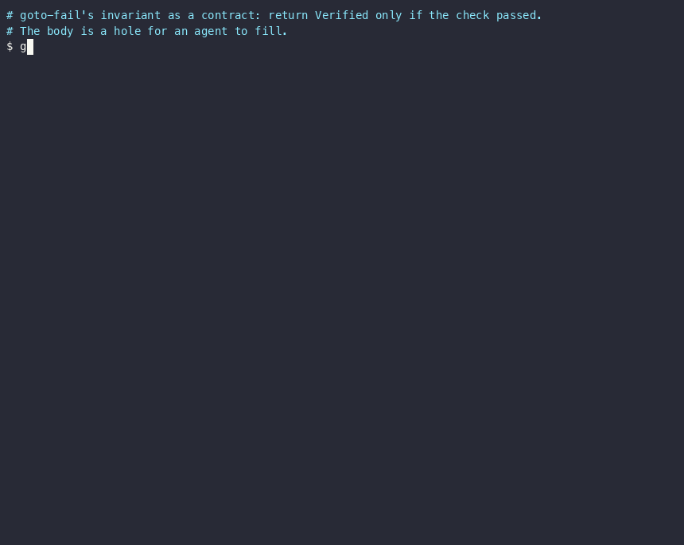

# LLMLL: AI agents fill function bodies; a verifier checks their contracts

*Burc Sahinoglu · 29 October 2026. A self-contained demonstration. The [five-post
series](index.md) tells the longer story, up to 163 functions.*

LLMLL is a programming language built for AI agents to write. A function starts as a contract,
a precondition and a postcondition, with a typed hole where the body goes. An agent checks the
hole out, proposes a body, and the compiler hands the body and the contract to an SMT solver.
A body the solver cannot prove is rejected before it lands, and the program is left as it was.

This page runs that loop once, on the invariant behind a real bug, and shows every diagnostic it
produces.

<p></p>

The two fills in the recording are scripted stand-ins for agents: fixed patch files committed to
the repository, so the rejection is reproducible. Script:
[`examples/gotofail/demo.sh`](https://github.com/machunter/llmll/blob/main/examples/gotofail/demo.sh).

## The contract

In 2014, Apple's goto-fail bug (CVE-2014-1266) reported a TLS handshake as successful on a path
where the signature check never ran. The mistake was about whether a check executes. Written as
a contract, the invariant is: return `Verified` only if the check passed.

```lisp
(type Step    (| Continue) (| Abort int))
(type Verdict (| Verified) (| Rejected int))

(def-shell finalize [sig: Step payload: int] -> Verdict
  (post (=> (= result Verified) (= sig Continue)))   ;; return Verified => sig was Continue
  ?body)
```

`?body` is the hole. An agent asks for it with `llmll checkout`, which locks the hole and returns
a brief: the postcondition, the return type, the names in scope and a lock token. The brief has
no reference body and no hint.

```json
{
  "postcondition_goal": "(=> (= result Verified) (= sig Continue))",
  "expected_return_type": "Verdict"
}
```

## A wrong fill is rejected

Say the agent makes the goto-fail mistake and returns `Verified` on every path:

```lisp
(match sig ((Continue) Verified) ((Abort c) Verified))
```

It submits the body as a JSON-Patch against the program's JSON-AST, with `--require-proof`:

```
$ llmll patch finalize-hole.ast.json wrong.json --require-proof
{
  "diagnostics": [
    {
      "kind": "lh-unsafe",
      "message": "body verification of 'finalize' failed (else-branch does not satisfy postcondition) (constraint #1)",
      "pointer": "patch-op/1",
      "severity": "error"
    }
  ],
  "result": "PatchVerifyError"
}
```

The patch is refused and the file is byte-for-byte unchanged. The diagnostic names the branch
that fails: the `else` branch, the one that returns `Verified` when `sig` is `Abort`. That is
the input the real bug shipped on.

## The guarded fill is accepted

```lisp
(match sig ((Continue) Verified) ((Abort c) (Rejected c)))
```

```
$ llmll patch finalize-hole.ast.json right.json --require-proof
{"result":"PatchSuccess","reuse_suggestions":[],"statements":3,"verification":[{"body_faithful":true,"fn":"finalize"}]}

$ llmll verify finalize-hole.ast.json
   body-faithful: finalize
   Running liquid-fixpoint ...
✅ finalize-hole.ast.json — SAFE (liquid-fixpoint)
```

`body_faithful` means the solver proved the postcondition from the body itself. It did not
assume the contract.

## Which pass rejects it

The rejection comes from the verifier, not from the type checker. `llmll build` checks types and
emits Haskell, and it compiles the wrong body without complaint. The proof runs in `llmll
verify`, and in `llmll patch`, which re-verifies the patched function before writing anything.
With `--require-proof`, a patch is also refused when its function passes only because the
solver fell back to assuming the postcondition.

## What this shows, and what it does not

**For people building agent tools.** The agent gets a structured contract instead of a prose
ticket. A rejection comes back as JSON with a kind, a message and a pointer into the patch, so a
repair loop can act on it without parsing compiler text. A rejected patch changes nothing, and
the checkout lock stays with the agent so it can try again.

**For programming-language researchers.** The verifier is not the new part: Dafny, Liquid
Haskell or F\* would reject the same body. LLMLL's proofs run on liquid-fixpoint and Z3. What the
project explores is the loop around the proof: holes as contracts, checkout and patch, how
contracts compose across calls ([Post 3](blog/post-3-composition-and-the-missing-bound.md)), and
how much of a contract's adequacy a tool can check at all
([Post 4](blog/post-4-who-writes-the-decomposition.md)).

**Scope.**

- The solver covers linear integer arithmetic, booleans, non-recursive sums, pairs, fixed-size
  bytes, maps and string literals. Outside that fragment a postcondition is assumed, `verify`
  names the function, and `--require-proof` refuses the fill.
- A proof shows that the body meets the contract. It does not show that the contract is right.
  Whether the contract says the right thing is a human reviewer's job.
- The example is one function. The series scales it up to an arithmetic model of the TLS record
  layer's control flow and bounds: 163 agent-written functions, verified as one program
  ([Post 5](blog/post-5-the-payoff.md)). That model computes no hash, MAC or cipher, and it is
  not a verified TLS implementation.
- A verdict trusts its tools: LLMLL's translation to solver constraints, liquid-fixpoint, Z3,
  the Haskell code generator and GHC.

## Run it

With Docker and nothing else, see the rejection:

```bash
docker run --rm ghcr.io/machunter/llmll verify /opt/llmll/examples/gotofail/finalize-bad.llmll
```

It prints `error: body verification of 'finalize' failed (else-branch does not satisfy
postcondition)`. Swap `finalize-bad` for `finalize` to see the guarded body verify.

To run the whole checkout-and-patch loop from the recording, build `llmll` from
[the repository](https://github.com/machunter/llmll) and run
`bash examples/gotofail/demo.sh`. It needs `liquid-fixpoint`, `z3` and `jq` on your PATH.

## Try to break it

Weaken the contract, or write a body that should fail, and report what the verifier accepts. A
wrong body that verifies is the most useful bug report this project can get:
[open an issue](https://github.com/machunter/llmll/issues).

## Read on

The [series](index.md) goes from this one function to 163:

1. [The bugs that looked like correct code](blog/post-1-the-bugs-that-looked-correct.md)
2. [A compiler that refuses](blog/post-2-a-compiler-that-refuses.md)
3. [Composition, and the bound that wasn't there](blog/post-3-composition-and-the-missing-bound.md)
4. [Can agents invent the helper functions too?](blog/post-4-who-writes-the-decomposition.md)
5. [163 agent-written functions, verified against their contracts](blog/post-5-the-payoff.md)
